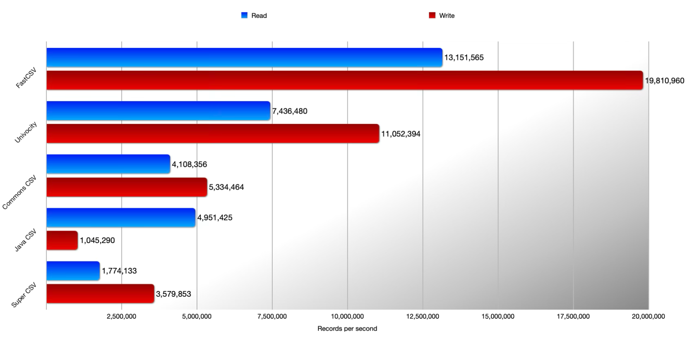

These goals guide the development of FastCSV.

## Performance

FastCSV reads and writes CSV data fast, without trading away compliance with the CSV specification, reliability or
security.

## Lightweight

FastCSV has no runtime dependencies and keeps its memory footprint small.
The JAR file is about 100 KiB.

## Compliant

FastCSV is built on [RFC 4180](https://datatracker.ietf.org/doc/html/rfc4180), and
[specification tests](https://github.com/osiegmar/FastCSV/tree/main/lib/src/intTest/resources/spec) check its
behavior against it.
The [CSV interpretation](/architecture/interpretation/) page explains how FastCSV handles real-world CSV data beyond
the RFC, such as LF line breaks or comments, and the cases the RFC leaves open, such as records with differing field
counts.
The [Java CSV Comparison Project](https://github.com/osiegmar/JavaCsvComparison) shows how FastCSV handles edge cases
compared to other libraries.

## Simplicity

The API is small and does what its names say. The [Quickstart](/guides/quickstart/) gives a first impression.

## Reliability

Besides the [test coverage](https://app.codecov.io/gh/osiegmar/FastCSV),
[PIT mutation testing](https://pitest.org) checks that the tests actually catch faults.

Some documented methods accept `null` arguments; no public API returns `null`.

## Security

FastCSV follows the Open Source Security Foundation (OpenSSF) Best Practices;
see the [Best Practices](https://www.bestpractices.dev/projects/9141) report.
It is also part of [OSS-Fuzz](https://google.github.io/oss-fuzz/).

## Documentation

Every feature is documented, on this website and in the [Javadoc](https://javadoc.io/doc/de.siegmar/fastcsv).

## Maintainability and support

[SpotBugs](https://spotbugs.github.io),
[PMD](https://pmd.github.io),
[Error Prone](https://errorprone.info),
[NullAway](https://github.com/uber/NullAway) and
[Checkstyle](https://checkstyle.sourceforge.io) keep the code maintainable.
The [FAQ](/faq/) explains how to get help and how to contribute.

## Non-goals

Flexibility and extensibility are not design goals. They are considered only where they don't conflict with the goals
above.
